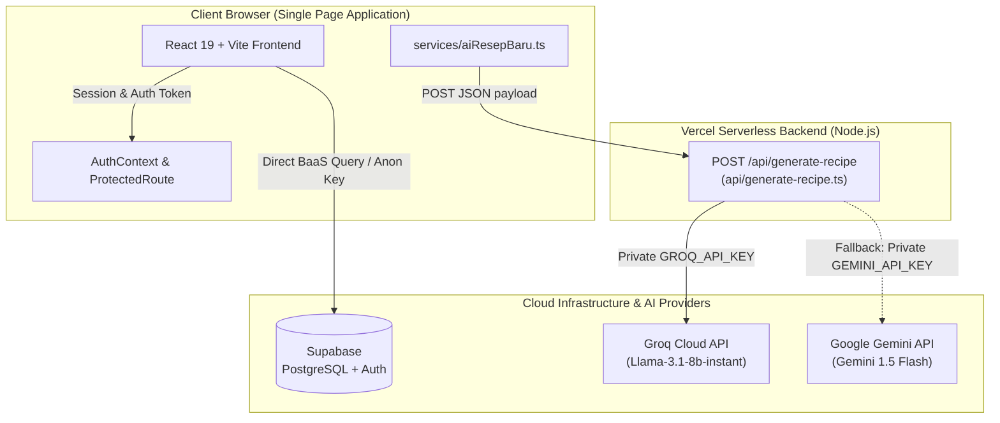

# Buku Resep Digital — Balista Sushi & Tea

Aplikasi web modern berbasis Single Page Application (SPA) untuk standarisasi Standard Operating Procedure (SOP) pembuatan menu kuliner, manajemen resep dapur, monitoring akses tim outlet, dan integrasi generasi SOP otomatis berbantuan AI (*AI-assisted recipe generation*).

Aplikasi ini awalnya diinisiasi dari scaffold Google AI Studio, kemudian dikembangkan dan disesuaikan menjadi sistem internal restoran oleh tim beranggotakan 2 orang.

---

## Ringkasan Eksekutif (2-Minute Overview)

* **Tujuan Utama:** Menghilangkan disparitas rasa dan SOP operasional antar-outlet kuliner melalui digitalisasi resep interaktif serta menjaga kerahasiaan operasional menu restoran.
* **Arsitektur:** Client-side React 19 yang responsif dengan komunikasi database langsung ke Supabase (PostgreSQL BaaS), serta pemrosesan AI terisolasi di sisi server melalui Vercel Serverless Functions (`/api/generate-recipe`) untuk mencegah kebocoran API key.
* **Status Proyek:** Siap pakai (*production-ready*) dengan portofolio fitur lengkap untuk kebutuhan operasional kitchen crew dan manajemen office.

---

## Fitur Utama (Berdasarkan Kode Sumber)

### 1. Galeri Resep Interaktif (Kitchen Crew & Admin)
* **Smart Filter & Multi-Criteria Sorting:** Pencarian menu berdasarkan nama resep, bahan, maupun deskripsi; penyaringan kategori dinamis; dan pengurutan (Terbaru, Terlama, A–Z, Z–A).
* **Voice Search:** Pencarian resep hands-free menggunakan Web Speech API (`webkitSpeechRecognition`), memudahkan staf dapur saat tangan sedang bekerja.
* **Dual View Modes:** Pilihan visualisasi antara Grid Card standar atau Mode Akordeon (*Group by Category*).
* **Fast Image Rendering:** Konversi otomatis URL Google Drive ke Google User Content CDN (`lh3.googleusercontent.com`) dengan lazy-loading dan fallback placeholder.

### 2. Standar Operasional Prosedur (SOP) Dapur
* **Parsing Terstruktur:** Otomasi ekstraksi data bahan (nama, takaran, satuan), alat masak, dan porsi penyajian.
* **Numbered Method Steps:** Langkah-langkah pembuatan ditampilkan berurutan secara bertahap (*step-by-step guidance*).

### 3. Manajemen Resep & Kategori (Admin Dashboard)
* **Full CRUD Resep:** Penambahan, pembaruan, dan penghapusan resep dengan modal verifikasi status kelengkapan SOP (*Lengkap* vs *Belum Lengkap* beserta pencatatan alasan).
* **Manajemen Kategori Dinamis:** Pengelolaan kategori menu yang langsung terhubung ke database Supabase.
* **Mini Analytics:** Ringkasan total menu, persentase kelengkapan SOP, dan visualisasi distribusi kategori menu.

### 4. AI-Powered Recipe Generation (Secure Serverless Architecture)
* Pembuatan draf SOP otomatis (deskripsi + langkah pembuatan) berbasis nama menu, bahan, dan alat masak melalui endpoint backend Vercel Serverless Functions (`/api/generate-recipe`).
* Didukung model bahasa performa tinggi (*Groq Llama 3.1 8B Instant* dengan fallback otomatis ke *Google Gemini 1.5 Flash*).

### 5. Manajemen Tim & Pengawasan Akses (*Access Activity*)
* **Device & Session Monitoring:** Pendeteksian browser, OS, dan tipe perangkat (*mobile/desktop*) sesi aktif berbasis User Agent parsing.
* **Manajemen Pengguna Internal:** Admin dapat membuat akun baru untuk kru dan mengelola hak akses (*Admin* vs *Crew*).
* **Self-Service Password Update:** Pengguna yang aktif dapat memperbarui kata sandi secara langsung.

### 6. Proteksi UI & Pencegahan Kebocoran Data (*Client-Side Data Defense*)
* **Security Overlay:** Layar aplikasi otomatis terkunci (*blur blackout*) ketika tab browser kehilangan fokus atau pengguna berpindah aplikasi.
* **Anti-Copy & Anti-DevTools Helper:** Pencegahan klik kanan, seleksi teks resep, dan media query cetak (`@media print`) yang menyembunyikan konten jika terdeteksi perintah cetak/ekspor layar.

---

## Arsitektur Sistem

Pemanggilan API AI (Groq / Gemini) dialihkan dari browser ke Vercel Serverless Function di sisi server demi melindungi *secret credentials*.



---

## Tech Stack

| Layer | Teknologi |
|---|---|
| **Frontend Framework** | React 19, TypeScript, Vite 6 |
| **Routing & Auth State** | React Router DOM v7, React Context API |
| **Styling & UI Effects** | Tailwind CSS (CDN Engine), Glassmorphism UI, Custom CSS Keyframe Orbs |
| **Backend & Database** | Supabase (PostgreSQL Database, GoTrue Auth, Row Level Security) |
| **Serverless Backend** | Vercel Serverless Functions (TypeScript/Node.js) |
| **AI Providers** | Groq Cloud (Llama 3.1 8B) & Google Gemini (1.5 Flash) |
| **Notification** | React Hot Toast |
| **Data Utility** | PapaParse (CSV parser) |

---

## Panduan Menjalankan Proyek (*Getting Started*)

### Prasyarat
* Node.js versi 18 ke atas
* npm versi 9 ke atas

### Langkah Instalasi

1. **Clone repository dan masuk ke direktori proyek:**
   ```bash
   git clone https://github.com/tasya/digital-recipe.git
   cd digital-recipe
   ```

2. **Instal dependensi:**
   ```bash
   npm install
   ```

3. **Konfigurasi Environment Variables:**
   Salin file template `.env.example` ke `.env.local`:
   ```bash
   cp .env.example .env.local
   ```
   Isi konfigurasi sesuai kredensial Anda:
   ```env
   # Frontend Client (Wajib)
   VITE_SUPABASE_URL=https://your-project.supabase.co
   VITE_SUPABASE_ANON_KEY=your-supabase-anon-key

   # Serverless Backend AI (Opsional untuk fitur AI di Vercel / server)
   GROQ_API_KEY=gsk_your_groq_api_key
   GEMINI_API_KEY=your_gemini_api_key
   ```

4. **Jalankan local development server:**
   ```bash
   npm run dev
   ```
   Buka peramban pada alamat `http://localhost:3000`.

5. **Build untuk produksi:**
   ```bash
   npm run build
   ```

---

## Tangkapan Layar Aplikasi (*Screenshots*)

> *Catatan: Seluruh data resep dan foto di bawah merupakan dummy data untuk keperluan demonstrasi.*

| Halaman | Pratinjau |
|---|---|
| **Galeri Resep** | `TODO(Tasya): Tambahkan screenshot galeri resep dengan dummy data` |
| **Detail SOP Menu** | `TODO(Tasya): Tambahkan screenshot tampilan detail langkah SOP resep` |
| **Admin Dashboard** | `TODO(Tasya): Tambahkan screenshot tabel kelola menu dan statistik` |
| **Login Activity & Tim** | `TODO(Tasya): Tambahkan screenshot monitoring sesi akun dan device` |

---

## Kontributor & Pembagian Peran

Proyek ini dibangun secara kolaboratif oleh tim 2 orang:

| Kontributor | Kontribusi Berdasarkan Riwayat Git (`git log`) |
|---|---|
| **heyjule** (`julianiputri077@gmail.com`) | • Inisialisasi awal integrasi AI (Gemini & Groq) di `services/`.<br>• Implementasi awal fetch dan visualisasi data resep dari database Supabase.<br>• Integrasi aset branding logo dan setup konfigurasi awal Vercel deployment.<br>• Penambahan fungsionalitas manajemen akun outlet. |
| **Tasya / syaurr** (`urfahtasya@gmail.com`) | • Desain ulang antarmuka modern (*Glassmorphism*, palet Balista, animasi orbs, responsivitas mobile).<br>• Arsitektur CRUD komprehensif untuk Resep dan Kategori (validasi form, dynamic steps/ingredients, filter/sort).<br>• Implementasi fitur keamanan klien (Security Overlay, proteksi anti-copy/anti-print, ProtectedRoute).<br>• Pengembangan dasbor admin, status verifikasi kelengkapan SOP, dan monitoring aktivitas sesi/device.<br>• Refaktorisasi arsitektur keamanan serverless API (`api/generate-recipe.ts`) dan pembersihan dependensi. |
| **Peran Lainnya** | `TODO(Tasya): Lengkapi pembagian tugas non-commit (misal: pengumpulan data resep, wawancara operasional restoran, usability testing).` |

---

## Lisensi & Atribusi
Hak Cipta (c) Balista Sushi & Tea. Dikembangkan untuk keperluan operasional internal dan portofolio teknis tim pengembang.
Dokumentasi artefak internal Google AI Studio telah diarsipkan di `docs/archive/metadata.json`.
