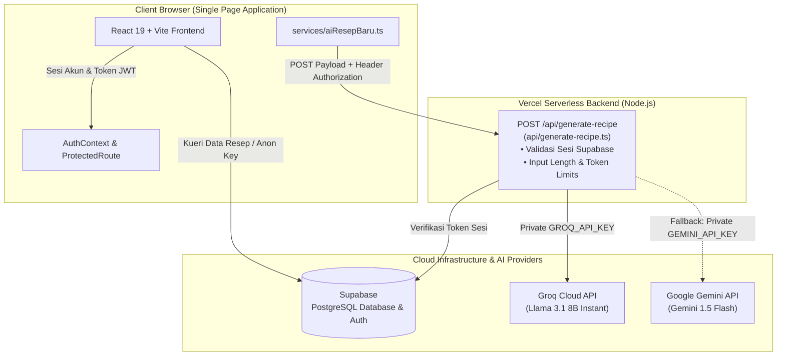

# Buku Resep Digital — Balista Sushi & Tea

## 1. Tujuan
Aplikasi web *Single Page Application* (SPA) ini bertujuan untuk mendigitalkan dan menstandarisasi *Standard Operating Procedure* (SOP) pembuatan menu kuliner di seluruh gerai/outlet restoran. Sistem ini dirancang untuk:
* Menghilangkan disparitas rasa dan inkonsistensi penyajian antar-outlet melalui panduan takaran bahan dan langkah operasional yang terpusat.
* Memfasilitasi staf dapur (*kitchen crew*) dalam mengakses instruksi memasak secara interaktif dan cepat di lingkungan kerja dapur.
* Membantu tim manajemen/kantor pusat dalam mengelola katalog resep, memonitor kelengkapan SOP, dan mengawasi aktivitas akses akun staf.
* Menyediakan pembuatan draf SOP secara otomatis berbantuan AI (*AI-assisted recipe generation*) dengan arsitektur serverless yang aman.

---

## 2. Fitur (Berdasarkan Kode Sumber)

### A. Galeri & Pencarian Resep (`pages/Home.tsx`, `components/RecipeCard.tsx`, `components/AccordionView.tsx`)
* **Pencarian Multi-Kriteria:** Pencarian teks berdasarkan nama menu, bahan-bahan, atau deskripsi resep secara instan.
* **Voice Search:** Pencarian hands-free berbasis suara menggunakan Web Speech API (`webkitSpeechRecognition`), memudahkan staf saat tangan aktif di dapur.
* **Penyaringan & Pengurutan:** Filter berdasarkan kategori dinamis serta opsi pengurutan (Terbaru, Terlama, Nama A–Z, Nama Z–A).
* **Mode Tampilan Ganda:** Pilihan visualisasi antara tampilan kisi (*Grid Card View*) dan mode akordeon terkelompok per kategori (*Accordion Grouped View*).
* **CDN Image Resolver:** Konversi otomatis tautan gambar Google Drive menjadi URL CDN Google User Content (`lh3.googleusercontent.com`) dengan penanganan fallback placeholder jika gambar gagal dimuat.

### B. Detail Standar Operasional Prosedur (`pages/RecipeDetail.tsx`, `components/PortionCalculator.tsx`)
* **Pengelompokan Komponen Masak:** Parsing dan visualisasi terpisah untuk takaran bahan, satuan, alat masak yang dibutuhkan, dan porsi penyajian standar.
* **Panduan Bertahap (*Step-by-Step*):** Langkah pembuatan disajikan berurutan dan terstruktur dengan penomoran jelas.

### C. Manajemen Resep & Kategori Admin (`pages/admin/RecipeForm.tsx`, `pages/admin/CategoryManager.tsx`, `pages/admin/AdminDashboard.tsx`)
* **Operasi CRUD Lengkap:** Pembuatan, pembaruan, dan penghapusan resep beserta bahan dan alat secara dinamis.
* **Audit Kelengkapan SOP:** Verifikasi status SOP (*Lengkap* vs *Belum Lengkap*) dengan pencatatan alasan spesifik (misal: bahan/langkah belum diverifikasi).
* **Manajemen Kategori:** Penambahan, pengeditan, dan penghapusan kategori menu yang terhubung ke database Supabase.
* **Metrik Operasional:** Ringkasan total menu, persentase kelengkapan SOP, dan distribusi kategori menu.

### D. Otomasi Pembuatan SOP Berbantuan AI (`services/aiResepBaru.ts`, `api/generate-recipe.ts`)
* **Draf SOP Otomatis:** Menghasilkan deskripsi dan urutan langkah pembuatan menu terstruktur dari nama menu, daftar bahan, dan alat.
* **Multi-Provider Serverless Fallback:** Pemrosesan AI dieksekusi di backend Vercel Serverless Function menggunakan *Groq Llama 3.1 8B Instant* dengan fallback otomatis ke *Google Gemini 1.5 Flash*.

### E. Manajemen Tim & Pengawasan Akses (`pages/CrewManagement.tsx`, `pages/OurTeam.tsx`)
* **Monitoring Sesi & Perangkat:** Parsing User Agent untuk mendeteksi nama browser, sistem operasi, dan tipe perangkat (*mobile/desktop*) serta status keaktifan sesi.
* **Manajemen Akun Kru:** Admin dapat mendaftarkan akun baru untuk staf dapur dan mengatur role (*Admin* / *Crew*).
* **Pembaruan Mandiri Kata Sandi:** Antarmuka pembaruan kata sandi bagi pengguna yang sedang aktif.

### F. Proteksi Tampilan & Pencegahan Kebocoran Data (`components/SecurityOverlay.tsx`, `components/ProtectedRoute.tsx`)
* **Security Overlay:** Menutup layar (*blackout blur*) otomatis saat tab peramban kehilangan fokus atau beralih aplikasi.
* **Anti-Copy & Anti-Print:** Pencegahan klik kanan, pemblokiran seleksi teks resep, dan media query cetak (`@media print`) untuk menyembunyikan resep saat upaya ekspor/cetak terdeteksi.
* **Route Guarding:** Validasi status login dan peran pengguna sebelum merender halaman operasional internal.

---

## 3. Tech Stack

| Layer / Kategori | Teknologi | Deskripsi Penggunaan |
|---|---|---|
| **Frontend Framework** | React 19, TypeScript | Komponen UI modular dengan deklarasi tipe data yang ketat. |
| **Build Tool** | Vite 6 | Bundler modern dengan *Fast Refresh* dan build produksi teroptimasi. |
| **Routing** | React Router DOM v7 | Manajemen navigasi halaman dan rute terproteksi (*protected routes*). |
| **Database & Auth** | Supabase (PostgreSQL, GoTrue) | Database relasional untuk resep/kategori/profil serta autentikasi pengguna. |
| **Serverless API** | Vercel Serverless Functions | Backend endpoint (`api/`) untuk mengisolasi kredensial dan pemanggilan API AI. |
| **AI LLM Inference** | Groq Cloud & Google Gemini | Inferensi model bahasa via Llama 3.1 8B dan Gemini 1.5 Flash. |
| **Styling** | Tailwind CSS & Glassmorphism | Desain antarmuka responsif dengan aksen warna khas restoran. |
| **Notifikasi** | React Hot Toast | Feedback visual non-blocking untuk interaksi CRUD dan autentikasi. |
| **Utilitas Data** | PapaParse | Parser CSV untuk pemrosesan data tabular. |

---

## 4. Arsitektur Sistem

Seluruh pemanggilan model AI (Groq & Gemini) dialihkan dari peramban (*client-side*) ke Vercel Serverless Function di sisi server (`api/generate-recipe.ts`). Hal ini memastikan *API keys* tidak pernah terekspos ke bundel JavaScript publik.



---

## 5. Cara Menjalankan Proyek

### Prasyarat
* Node.js versi 18 ke atas
* npm versi 9 ke atas

### Langkah Menjalankan Secara Lokal

1. **Clone repository:**
   ```bash
   git clone https://github.com/tasya/digital-recipe.git
   cd digital-recipe
   ```

2. **Instal seluruh dependensi:**
   ```bash
   npm install
   ```

3. **Siapkan environment variables:**
   Salin berkas template `.env.example` ke `.env.local`:
   ```bash
   cp .env.example .env.local
   ```
   Variabel yang dikonfigurasi pada `.env.local`:
   * `VITE_SUPABASE_URL`
   * `VITE_SUPABASE_ANON_KEY`
   * `GROQ_API_KEY`
   * `GEMINI_API_KEY`

4. **Jalankan development server:**
   ```bash
   npm run dev
   ```
   Aplikasi dapat diakses melalui peramban pada `http://localhost:3000`.

5. **Uji build produksi:**
   ```bash
   npm run build
   ```

---

## 6. Konfigurasi Deploy di Vercel

Saat mendeploy proyek ke platform Vercel, daftarkan variabel lingkungan berikut pada menu **Project Settings > Environment Variables**:

### A. Environment Variables Client (Vite)
* `VITE_SUPABASE_URL`
* `VITE_SUPABASE_ANON_KEY`

### B. Environment Variables Server (Vercel Serverless Functions)
* `GROQ_API_KEY`
* `GEMINI_API_KEY`
* `SUPABASE_URL` *(opsional jika menggunakan `VITE_SUPABASE_URL`)*
* `SUPABASE_ANON_KEY` *(opsional jika menggunakan `VITE_SUPABASE_ANON_KEY`)*

> **Catatan Keamanan:** Kunci `GROQ_API_KEY` dan `GEMINI_API_KEY` TIDAK boleh memakai awalan `VITE_` agar tidak disertakan ke dalam bundel aset statis publik.

---

## 7. Tangkapan Layar Aplikasi (*Screenshots*)

> *Catatan: Data resep dan identitas kru pada screenshot berikut menggunakan data dummy non-sensitif.*

| Tampilan Halaman | Pratinjau Antarmuka |
|---|---|
| **Galeri Katalog Resep** | `TODO(Tasya): Tambahkan screenshot galeri katalog resep dengan data dummy` |
| **Detail SOP & Takaran Bahan** | `TODO(Tasya): Tambahkan screenshot tampilan detail langkah SOP resep` |
| **Admin Dashboard & Metrik** | `TODO(Tasya): Tambahkan screenshot tabel resep dan indikator kelengkapan SOP` |
| **Manajemen Tim & Login Activity** | `TODO(Tasya): Tambahkan screenshot daftar akun kru dan monitoring sesi` |

---

## 8. Asal Proyek

Proyek ini awalnya diinisiasi dari scaffold otomatis **Google AI Studio**, kemudian dikembangkan, dimodifikasi arsitekturnya, dan disesuaikan menjadi sistem aplikasi operasional internal restoran oleh tim pengembang. Dokumentasi berkas metadata scaffold bawaan telah diarsipkan secara rapi di `docs/archive/metadata.json`.

---

## 9. Kontributor & Pembagian Peran

Proyek ini dikembangkan secara kolaboratif oleh tim beranggotakan 2 orang:

| Kontributor | Kontribusi Berdasarkan Riwayat Git (`git log`) |
|---|---|
| **heyjule** (`julianiputri077@gmail.com`) | • Inisialisasi awal integrasi AI (Gemini & Groq) di direktori `services/`.<br>• Implementasi awal pengambilan dan rendering data resep dari database Supabase.<br>• Integrasi aset branding visual logo dan konfigurasi awal file deployment Vercel.<br>• Penambahan fungsi dasar pembuatan akun pengguna untuk outlet. |
| **Tasya / syaurr** (`urfahtasya@gmail.com`) | • Desain ulang antarmuka modern (*Glassmorphism*, palet warna Balista, animasi keyframe, responsivitas mobile).<br>• Arsitektur CRUD komprehensif untuk Resep dan Kategori (validasi form dinamis, audit kelengkapan SOP, filter/sorting).<br>• Implementasi fitur keamanan sisi klien (Security Overlay, proteksi anti-copy/anti-print, ProtectedRoute).<br>• Pengembangan dasbor analitik admin dan monitoring sesi/perangkat kru.<br>• Refaktorisasi keamanan backend serverless (`api/generate-recipe.ts`), pembersihan dependensi, dan eliminasi paparan secret. |
| **Tugas Non-Coding / Operasional** | `TODO(Tasya): Lengkapi pembagian tugas non-commit (seperti wawancara alur dapur outlet, riset operasional restoran, usability testing, dan penyusunan SOP manual).` |
